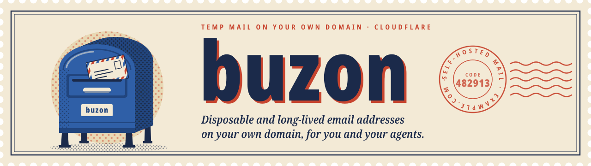
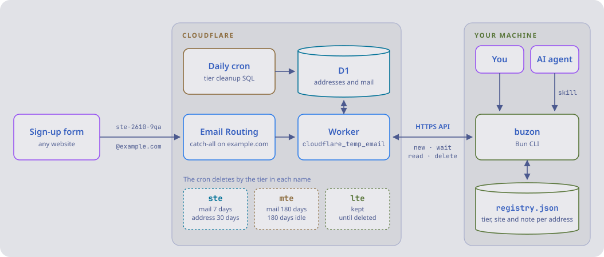

<div align="center">

<picture>
  <source media="(prefers-color-scheme: dark)" srcset="assets/banner/banner-dark.svg">
  
</picture>

[![License][license-badge]][license]
[![Bun][bun-badge]][bun]

---

[Install](#install) • [Quickstart](#quickstart) • [Commands](#commands) • [Agent skill](#agent-skill) • [How it works](#how-it-works) • [Docs](#docs)

---

</div>


buzon is a CLI for a self-hosted [cloudflare_temp_email](https://github.com/dreamhunter2333/cloudflare_temp_email)
instance, a mail server that runs on a Cloudflare Worker with D1.
It creates addresses on your domain, waits for the verification code or magic link, and keeps
a local record of which address belongs to which account.

- Three tiers in the address name: `ste` for one code, `mte` for a few weeks, `lte` for a real
  account. The instance deletes expired ones by itself.
- `wait --code` and `wait --link` print just the code or the link, ready for a script or an
  agent.
- A local registry of every address with its site and note, so "which address did I use for
  GitHub?" has an answer.
- Deploys and upgrades of the upstream release, with every database patch shown and confirmed.
- An agent skill that tells an AI agent when to pick each tier and how to get a code.

## Why

Public temp-mail services are blocked by most sign-up forms, and their inboxes are readable by
anyone who guesses the name. A catch-all on your own domain avoids both, but turns into a pile
of addresses nobody remembers. buzon puts a lifetime on each address, cleans up the short ones,
and records the long ones.

## Install

buzon runs on [Bun](https://bun.sh). It reads its passwords from `BUZON_SITE_PASSWORD` and
`BUZON_ADMIN_PASSWORD`, or else from the keyring: the Secret Service through `secret-tool` on
Linux, the Keychain on macOS. Until it is published, install it from source:

```sh
git clone https://github.com/shbernal/buzon
```

```sh
cd buzon && bun install && bun link
```

No instance yet? [docs/deploying.md](docs/deploying.md) goes from a domain on Cloudflare to a
running one.

## Quickstart

1. Store the instance's site password in the keyring, on Linux:

   ```sh
   secret-tool store --label="buzon site-password" service buzon key site-password
   ```

   On macOS:

   ```sh
   security add-generic-password -s buzon -a site-password -w
   ```

   Elsewhere, export `BUZON_SITE_PASSWORD` instead.

2. Point buzon at the instance. It checks that the instance answers, serves the domain and
   accepts the password before writing anything:

   ```sh
   buzon init --url https://mail.example.com --domain example.com
   ```

3. Create a one-shot address and use it on a sign-up form:

   ```sh
   buzon new ste
   ```

4. Wait for the code, then delete the address:

   ```sh
   buzon wait ste-2610-9qa --code --since 10m
   ```

   ```sh
   buzon delete ste-2610-9qa
   ```

For an account you will come back to, keep the address and say what it is for:

```sh
buzon new lte --site github --note "GitHub account for side projects"
```

## Commands

| Command                          | Does                                                       |
| -------------------------------- | ---------------------------------------------------------- |
| `new <ste\|mte\|lte>`            | Create an address, with `--site` and `--note`              |
| `new custom <name>`              | Create an address with a name you choose, such as `jane`   |
| `wait <address>`                 | Wait for new mail and print its `--code`, `--link` or text |
| `read <address>`                 | Print the latest mail, `--all`, or one `--id`              |
| `list`, `show <address>`         | Registry entries, filtered by `--tier` or `--site`         |
| `note`, `delete`, `adopt`        | Edit, remove, or take in an address made elsewhere         |
| `deploy`, `upgrade`, `export-db` | Ship a release, move to a newer one, dump the database     |

Every command takes `--json`. `buzon --help` lists every command and flag.

## Agent skill

<picture>
  <source media="(prefers-color-scheme: dark)" srcset="assets/agent-session/agent-session-dark.svg">
  
</picture>

[`skills/buzon`](skills/buzon/SKILL.md) teaches an agent to pick the tier, get a code or link,
and find an address again later. Install it with:

```sh
npx skills add shbernal/buzon
```

A test fails the build when the skill names a command or flag the CLI does not have.

## How it works

<picture>
  <source media="(prefers-color-scheme: dark)" srcset="assets/how-it-works/how-it-works-dark.svg">
  
</picture>

Cloudflare Email Routing hands every message for your domain to the Worker, which stores it in D1.
A daily cron deletes expired `ste` and `mte` addresses by the tier in their name.
buzon talks to the Worker over its HTTPS API, and keeps the registry of sites and notes on your
machine only.

## Docs

- [Deploying an instance](docs/deploying.md)
- [Tiers and cleanup](docs/tiers.md)
- [Files](docs/files.md)
- [Upgrading](docs/upgrading.md)

[license]: LICENSE
[license-badge]: https://img.shields.io/github/license/shbernal/buzon?style=for-the-badge&color=c8452f
[bun]: https://bun.sh
[bun-badge]: https://img.shields.io/badge/bun-%E2%89%A51.4-2f5fa7?style=for-the-badge&logo=bun&logoColor=white
